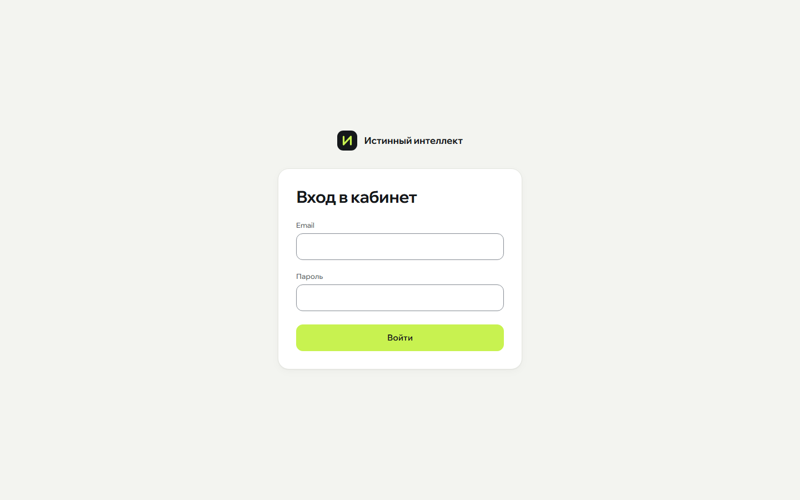
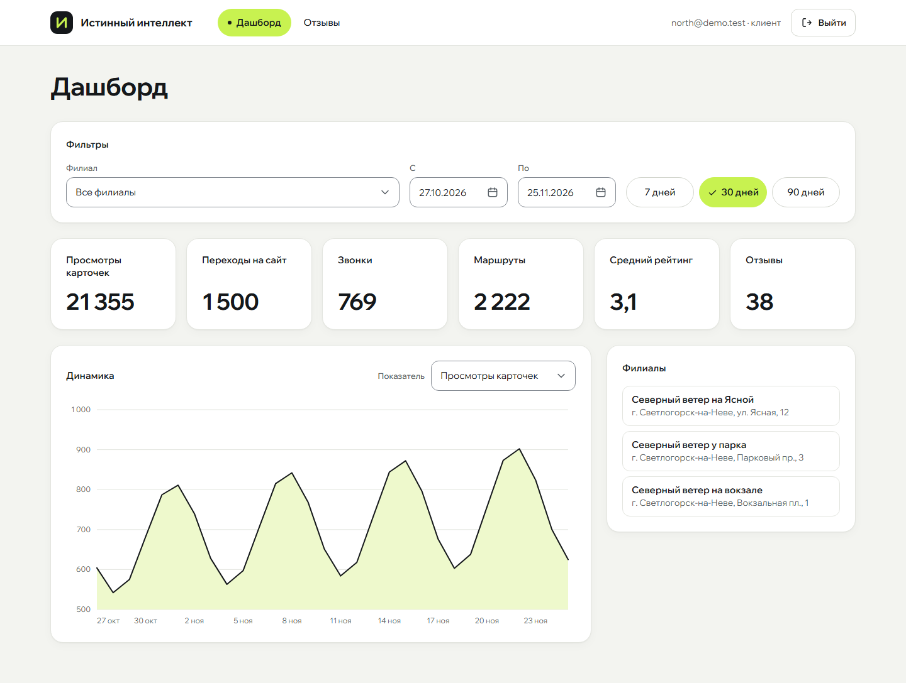
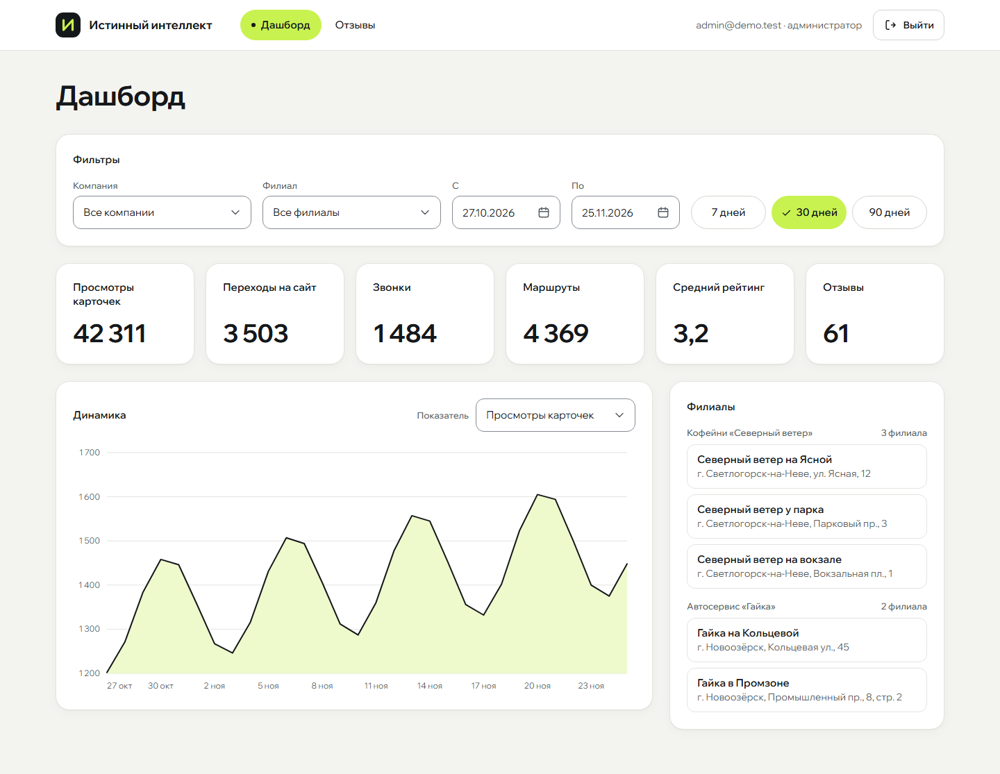
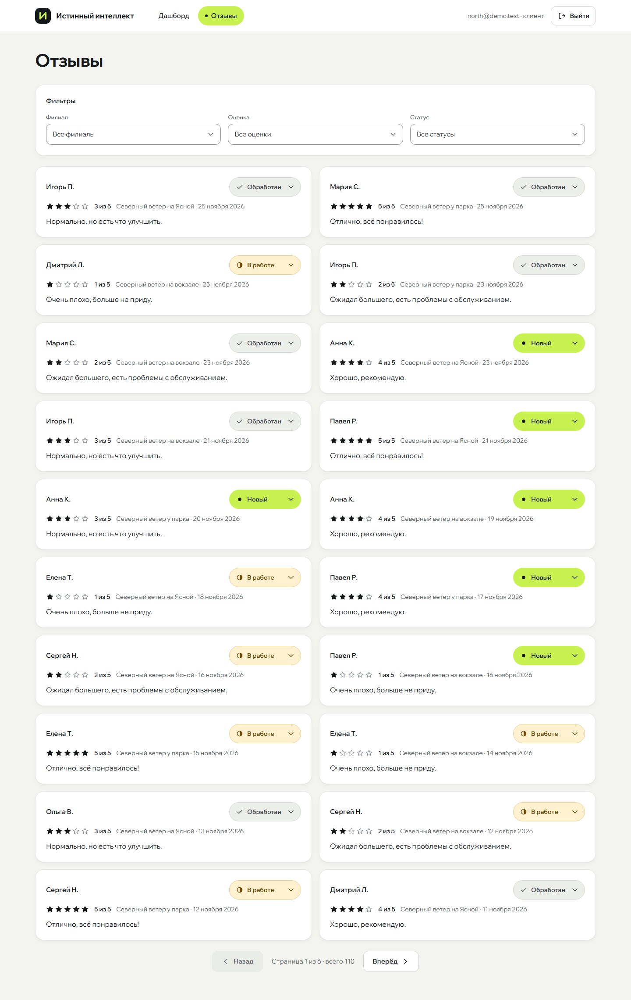
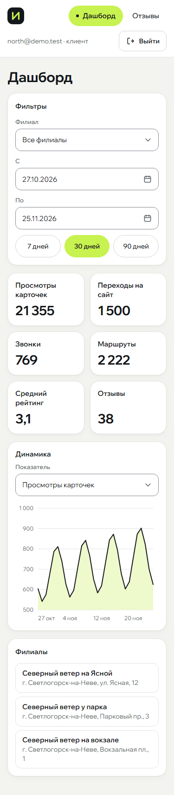
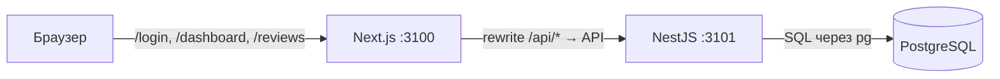

# Аналитический кабинет «Истинный интеллект»

Минимальная рабочая версия аналитического кабинета для клиентов, которые управляют несколькими филиалами и отслеживают присутствие бизнеса на геосервисах. Администратор видит все компании, клиент — только свою. Кабинет показывает просмотры карточек, переходы на сайт, звонки, маршруты, средний рейтинг и число отзывов по филиалам за выбранный период. Есть модуль отзывов с фильтрами по оценке и статусу и сменой статуса. Сделано по тестовому заданию; все данные вымышленные.

## Содержание

- [Возможности](#возможности)
- [Технологии](#технологии)
- [Быстрый старт (Docker)](#быстрый-старт-docker)
- [Локальная разработка без Docker](#локальная-разработка-без-docker)
- [Демо-учётные записи](#демо-учётные-записи)
- [npm-скрипты](#npm-скрипты)
- [Nginx](#nginx)
- [Конфигурация](#конфигурация)
- [Тестирование](#тестирование)
- [Качество кода](#качество-кода)
- [Скриншоты](#скриншоты)
- [Архитектура](#архитектура)
- [Структура проекта](#структура-проекта)
- [Известные ограничения](#известные-ограничения)
- [Масштабирование до 500+ компаний](#масштабирование-до-500-компаний)

## Возможности

| Пункт ТЗ                 | Что реализовано                                                                                                                                                                                                                                                             |
| ------------------------ | --------------------------------------------------------------------------------------------------------------------------------------------------------------------------------------------------------------------------------------------------------------------------- |
| 1. Авторизация и роли    | Вход по email и паролю, сессия в `HttpOnly`-cookie. Роли `admin` (все компании, выбор компании в интерфейсе) и `client` (только своя компания). Права проверяет сервер; чужие `companyId`, `branchId` и отзывы недоступны и через интерфейс, и прямым запросом к API (404). |
| 2. Аналитический дашборд | Просмотры карточек, переходы на сайт, звонки, маршруты, средний рейтинг, число отзывов. Фильтры по филиалу и периоду. График динамики выбранного показателя по дням.                                                                                                        |
| 3. Работа с филиалами    | Список филиалов, выбор филиала и его статистика. Без выбора — агрегат по всем доступным филиалам.                                                                                                                                                                           |
| 4. Backend и база данных | REST API на NestJS, PostgreSQL. SQL-миграции и seed: 2 компании, 5 филиалов, 3 пользователя, показатели и отзывы за 90 дней.                                                                                                                                                |
| 5. Модуль отзывов        | Страница `/reviews` с фильтрами по оценке, статусу обработки и филиалу, пагинацией и сменой статуса.                                                                                                                                                                        |

Общие требования: все данные приходят реальными запросами к API, изменения сохраняются в PostgreSQL, у каждого блока есть состояния загрузки, ошибки (с кнопкой «Повторить») и пустых данных. Фильтры хранятся в URL.

## Технологии

| Слой           | Технология                                  | Версия             |
| -------------- | ------------------------------------------- | ------------------ |
| Runtime        | Node.js                                     | 24                 |
| Frontend       | Next.js (App Router, standalone)            | 16.4.6             |
| Frontend       | React                                       | 19.3.1             |
| Язык           | TypeScript                                  | 5.9.3              |
| Backend        | NestJS (`@nestjs/core`, `platform-express`) | 12.6.0             |
| Доступ к БД    | `pg` (без ORM)                              | 8.23.1             |
| База данных    | PostgreSQL (образ `postgres:17`)            | 17                 |
| Контейнеры     | Docker Compose                              | —                  |
| Тесты API      | `node:test` + `fetch`                       | встроены в Node.js |
| E2E-тесты      | Playwright (`@playwright/test`)             | 1.65.1             |
| Линтер         | ESLint, typescript-eslint                   | 10.15.0, 8.74.0    |
| Форматирование | Prettier                                    | 3.10.1             |
| CI             | GitHub Actions                              | —                  |

Стек — предпочтительный из ТЗ, без замен.

## Быстрый старт (Docker)

Нужен только Docker; Node.js на хосте не требуется. Из корня проекта:

PowerShell:

```powershell
Copy-Item .env.example .env
docker compose up -d --build --wait
```

bash:

```bash
cp .env.example .env
docker compose up -d --build --wait
```

Команда собирает образы `api` и `web`, применяет миграции, заполняет пустую базу тестовыми данными и возвращает управление, когда службы `db`, `api`, `web` и `nginx` здоровы.

| Служба     | Адрес                                                                                                        |
| ---------- | ------------------------------------------------------------------------------------------------------------ |
| Кабинет    | <https://127.0.0.1:8443> (через Nginx; сертификат самоподписанный — браузер попросит подтвердить исключение) |
| Next.js    | <http://127.0.0.1:3100> (напрямую, для разработки и тестов)                                                  |
| API        | <http://127.0.0.1:3101> (статус: <http://127.0.0.1:3101/health>)                                             |
| PostgreSQL | `127.0.0.1:54527` (порт из `PGPORT` в `.env`)                                                                |

Порты публикуются только на `127.0.0.1`.

Управление стеком:

```bash
docker compose exec api npm run test:dist   # тесты API внутри контейнера
docker compose down                          # остановка, данные сохраняются
docker compose down -v                       # остановка и удаление данных
```

Повторный `up` без `-v` данные не трогает: seed запускается с `--if-empty`, изменённые статусы отзывов сохраняются.

## Локальная разработка без Docker

Нужны Node.js 24 с npm. PostgreSQL удобнее всего поднять той же службой `db` из Compose. Docker-стек и dev-режим занимают одни и те же порты 3100 и 3101: перед запуском выполните `docker compose down`.

PowerShell:

```powershell
npm.cmd ci
if (!(Test-Path -LiteralPath .env)) { Copy-Item .env.example .env }
docker compose up -d --wait db
npm.cmd run db:setup
```

bash:

```bash
npm ci
[ -f .env ] || cp .env.example .env
docker compose up -d --wait db
npm run db:setup
```

Затем в двух терминалах (в PowerShell — `npm.cmd`):

```bash
npm run dev:api   # NestJS в watch-режиме на 127.0.0.1:3101
npm run dev:web   # Next.js dev на 127.0.0.1:3100
```

`npm run db:setup` пересоздаёт тестовые данные: изменения и сессии удаляются.

## Демо-учётные записи

Пароль у всех — `demo-password`.

| Email             | Роль          | Доступ                                 |
| ----------------- | ------------- | -------------------------------------- |
| `admin@demo.test` | администратор | все компании и филиалы, выбор компании |
| `north@demo.test` | клиент        | Кофейни «Северный ветер», 3 филиала    |
| `gaika@demo.test` | клиент        | Автосервис «Гайка», 2 филиала          |

## npm-скрипты

Корневые скрипты (`package.json`):

| Скрипт                 | Что делает                                               |
| ---------------------- | -------------------------------------------------------- |
| `npm run dev:web`      | Next.js dev-сервер на `127.0.0.1:3100`                   |
| `npm run dev:api`      | NestJS в watch-режиме, переменные из `.env`              |
| `npm run build`        | сборка всех workspace (`api` и `web`)                    |
| `npm run db:setup`     | миграции и пересоздание тестовых данных                  |
| `npm test`             | `db:setup`, затем тесты API                              |
| `npm run test:e2e`     | e2e-тесты Playwright на Obscura против запущенного стека |
| `npm run lint`         | ESLint по всему репозиторию                              |
| `npm run format`       | Prettier, перезапись файлов                              |
| `npm run format:check` | Prettier, только проверка                                |

Скрипты `apps/api` (`npm run <скрипт> --workspace=api`):

| Скрипт            | Что делает                                                                                                         |
| ----------------- | ------------------------------------------------------------------------------------------------------------------ |
| `db:migrate`      | применяет SQL-миграции (`db/migrate.ts`)                                                                           |
| `db:seed`         | заливает тестовые данные (`db/seed.ts`); с `--if-empty` — только в пустую базу                                     |
| `test`            | `tsc` для `src` в `dist-test`, `tsc` для скриптов и тестов (`tsconfig.scripts.json`), затем `node --test`          |
| `test:dist`       | `node --test` против уже собранного `dist` в контейнере; без `contract.test.ts` — Ajv в продовый образ не ставится |
| `build` / `start` | сборка и запуск собранного API                                                                                     |

## Nginx

Служба `nginx` в `compose.yaml` — единая точка входа: <https://127.0.0.1:8443>; <http://127.0.0.1:8080> перенаправляет на HTTPS (кроме `/api/health` для healthcheck). Прямые порты 3100 и 3101 оставлены для разработки и тестов.

- Образ `nginxinc/nginx-unprivileged:1.28-alpine`, закреплён по digest; `read_only`, `tmpfs` для `/tmp` и `/var/cache/nginx`, `cap_drop: [ALL]`, `no-new-privileges`; порты `127.0.0.1:8080` и `127.0.0.1:8443`. Конфиг — `nginx/conf.d/default.conf` и `nginx/snippets/{proxy,security-headers}.conf`, монтируются только на чтение.
- **HTTPS.** TLS 1.2 и 1.3 (набор шифров Mozilla intermediate), HTTP/2, общий кеш TLS-сессий, session tickets выключены; TLS 1.1 и ниже отклоняются. Сертификат локально выпускает одноразовая служба `certs` (образ `postgres:17`, в нём есть `openssl`) в том `tls`, если его там ещё нет: конечный сертификат (`CA:FALSE`, `serverAuth`, SAN `localhost` и `127.0.0.1`), ключ доступен только пользователю nginx. В проде вместо тома монтируется настоящий сертификат в `/etc/nginx/tls`, а порт редиректа задаётся в `map $host $https_port_suffix` (пустой для 443).
- Маршруты: `/api/` → `api` (префикс `/api` срезается), `/` → `web`. `X-Forwarded-For` перезаписывается `$remote_addr`, а не дополняется, — клиент не может подменить IP, который видит лимит входа.
- Кеширование:

| Путь             | Политика                                                                                                                  |
| ---------------- | ------------------------------------------------------------------------------------------------------------------------- |
| `/_next/static/` | `proxy_cache` на 365 дней, `Cache-Control: public, max-age=31536000, immutable` (имена файлов с хешем)                    |
| HTML (`/`)       | `no-cache`: Next ставит пререндеру `s-maxage` на год, и общий кеш отдавал бы страницы со ссылками на чанки старого деплоя |
| `/api/`          | `no-store`                                                                                                                |

- gzip для текста, CSS, JS, JSON и SVG.
- Заголовки безопасности: `X-Content-Type-Options`, `X-Frame-Options`, `Referrer-Policy`, `Permissions-Policy`, `Cross-Origin-Opener-Policy`, `Cross-Origin-Resource-Policy`; HSTS (2 года, `includeSubDomains`) — только по HTTPS, в том числе когда TLS снимает балансировщик перед Nginx (`X-Forwarded-Proto`); для адреса `127.0.0.1` браузеры HSTS не запоминают. CSP приходит от Next и API. `X-Powered-By` и `x-nextjs-*` скрыты.
- Лимиты: `/api/` — 20 запросов/с на IP, burst 40; `/api/auth/login` — 30 запросов/мин, burst 20; превышение → 429. `limit_conn` 50 соединений на IP, `client_max_body_size 16k`, таймауты клиента 10 с, прокси — 5 с на подключение и 30 с на чтение и отправку.

## Конфигурация

Переменные берутся из `.env` в корне (шаблон — `.env.example`). Его читают Compose, `dev:api` и скрипты БД.

| Переменная   | Значение в `.env.example` | Назначение                                       |
| ------------ | ------------------------- | ------------------------------------------------ |
| `API_PORT`   | `3101`                    | порт API в dev-режиме                            |
| `PGHOST`     | `127.0.0.1`               | хост PostgreSQL для API и скриптов на хосте      |
| `PGPORT`     | `54527`                   | порт PostgreSQL, опубликованный Compose на хосте |
| `PGUSER`     | `intellect_dev`           | пользователь БД                                  |
| `PGPASSWORD` | `intellect_local_dev`     | пароль БД                                        |
| `PGDATABASE` | `intellect`               | имя базы                                         |

Дополнительно, вне `.env.example`:

| Переменная   | По умолчанию            | Назначение                                                                                                                   |
| ------------ | ----------------------- | ---------------------------------------------------------------------------------------------------------------------------- |
| `API_HOST`   | `127.0.0.1`             | адрес, на котором слушает API (в Compose — `0.0.0.0`)                                                                        |
| `API_ORIGIN` | `http://127.0.0.1:3101` | куда Next.js проксирует `/api/*`; при смене порта API задайте в `apps/web/.env.local`. В образе `web` фиксируется при сборке |

## Тестирование

### Интеграционные тесты API

73 теста на встроенном `node:test` и `fetch`, без моков. Тест поднимает `AppModule` с теми же настройками HTTP, что и `main.ts` (`app.setup.ts`), на случайном порту и ходит в него по HTTP с реальной PostgreSQL.

Тесты и скрипты БД написаны на TypeScript и запускаются Node.js 24 напрямую (type stripping), без сборки. Типы проверяет `tsc -p tsconfig.scripts.json`; `db/tsconfig.json` и `test/tsconfig.json` наследуют его, чтобы IDE подхватывала те же настройки.

| Файл                                 | Тестов | Что проверяет                                                                                                                                                                                                                                                                                                                                                                                                                                                                                       |
| ------------------------------------ | ------ | --------------------------------------------------------------------------------------------------------------------------------------------------------------------------------------------------------------------------------------------------------------------------------------------------------------------------------------------------------------------------------------------------------------------------------------------------------------------------------------------------- |
| `apps/api/test/isolation.test.ts`    | 13     | Изоляция компаний в обе стороны: 5 проверок для каждого из двух клиентов (видит только свои компанию и филиалы; чужие `companyId`/`branchId` → 404; сводка равна сводке администратора по его компании; отзывы только свои и учитывают фильтры; `PATCH` чужого отзыва → 404, статус не меняется). Плюс: неверные фильтры отзывов → 400, запрос без cookie → 401, клиент меняет статус своего отзыва                                                                                                 |
| `apps/api/test/auth.test.ts`         | 9      | Неверный пароль → 401 без cookie; cookie после выхода → 401; истёкшая сессия → 401; вход удаляет истёкшие сессии; вход принимает только JSON и отклоняет cross-site; cookie получает `Secure` только при входе по HTTPS; неудачные входы с одного IP исчерпывают корзину IP → 429 с `Retry-After` для любого email; неудачные входы в один аккаунт с 20 разных IP исчерпывают корзину аккаунта → 429 даже с верным паролем, другие аккаунты входят; заголовки безопасности есть, `X-Powered-By` нет |
| `apps/api/test/analytics.test.ts`    | 6      | Агрегат по компании равен сумме по филиалам; итоги по компаниям следуют за вставкой, изменением и удалением строк `daily_metrics`; средний рейтинг взвешен по отзывам; в динамике строка на каждый день; период по умолчанию заканчивается последним днём с данными; даты вне 2000..2100 и невалидные → 400                                                                                                                                                                                         |
| `apps/api/test/contract.test.ts`     | 44     | Реальные ответы API (успешные и ошибки, для всех ролей) сверяются со схемами `openapi.yaml`: Ajv 2020 + `ajv-formats`, лишние поля запрещены (`additionalProperties: false`)                                                                                                                                                                                                                                                                                                                        |
| `apps/api/test/token-bucket.test.ts` | 1      | Token Bucket: пачка из `capacity` попыток, затем один токен за интервал, запас не больше `capacity`, корзины разных IP независимы                                                                                                                                                                                                                                                                                                                                                                   |

Запуск на хосте (нужна запущенная база: `docker compose up -d --wait db`):

```bash
npm test
```

`npm test` применяет миграции и seed, компилирует API в `apps/api/dist-test` и запускает тесты. Отдельный каталог не затрагивает `dist`, поэтому работающий `dev:api` не ломается.

Запуск в контейнере — против собранного `dist`, без пересборки и перезаливки данных:

```bash
docker compose exec api npm run test:dist
```

### E2E-тесты

Playwright, 21 сценарий в каталоге `e2e/`, конфигурация — `playwright.config.ts`. Тесты идут против уже запущенного стека на <http://127.0.0.1:3100> в двух проектах: десктоп 1440 px и мобильный 375 px.

Браузер — [Obscura](https://github.com/h4ckf0r0day/obscura) v0.2.7 (headless-браузер на Rust, Apache-2.0); Playwright подключается к нему через `connectOverCDP`.

- `e2e/obscura-install.mts` скачивает только закреплённую версию и сверяет sha256 архива до распаковки; бинарь лежит в `e2e/.obscura/` (вне git), повторный запуск ничего не качает.
- `e2e/obscura-server.ts` (globalSetup) запускает `obscura serve --allow-private-network` на свободном порту со случайным токеном CDP, проверяет, что порт слушается только на loopback, и останавливает процесс после прогона.
- Сессии ставятся через `context.addCookies`: сохранение storageState в Obscura ограничено. Tracing в Obscura не реализован.

```bash
docker compose up -d --build --wait
npm run test:e2e
```

Через Nginx по HTTPS — на Chromium: `E2E_BASE_URL=https://127.0.0.1:8443 NODE_TLS_REJECT_UNAUTHORIZED=0 E2E_BROWSER=chromium npx playwright test` (`ignoreHTTPSErrors` в конфиге, переменная Node — для запросов к API из тестов, только для этого прогона). Obscura не умеет доверять самоподписанному сертификату (нет опции, проверка идёт по системному хранилищу), поэтому по умолчанию гоняется напрямую по HTTP на <http://127.0.0.1:3100>; с настоящим сертификатом от публичного CA этого ограничения нет.

Запасной вариант на Chromium (нужен `npx playwright install chromium`):

```bash
E2E_BROWSER=chromium npx playwright test
```

```powershell
$env:E2E_BROWSER='chromium'; npx playwright test; Remove-Item Env:E2E_BROWSER
```

### CI

`.github/workflows/ci.yml` запускается на каждый push и pull request. Действия закреплены по SHA.

| Задача   | Шаги                                                                                                                                                           |
| -------- | -------------------------------------------------------------------------------------------------------------------------------------------------------------- |
| `test`   | `npm ci`, `npm run lint`, `npm run format:check`, PostgreSQL через Compose, `npm run db:setup`, `npm test`, `npm run build`                                    |
| `e2e`    | `npm ci`, кеш `e2e/.obscura`, весь стек через Compose, `npm run test:e2e` (ставит Obscura с проверкой sha256); при падении — отчёт `e2e/.results` в артефактах |
| `docker` | `docker compose config`, сборка образов `api` и `web`                                                                                                          |

## Качество кода

- **ESLint 10**, flat config `eslint.config.ts`: `@eslint/js`, typescript-eslint с проверками по типам (`no-floating-promises`, `no-misused-promises`, `consistent-type-imports`), `eslint-plugin-react-hooks` и `@next/eslint-plugin-next` для `apps/web`, `eslint-config-prettier`.
- **Правила читаемости**: `id-length` (минимум 2 символа, исключения `_`, `x`, `y`), `max-depth` 3, `max-nested-callbacks` 3, `no-nested-ternary`.
- `@stylistic/padding-line-between-statements`: пустая строка после импортов и директив, после объявлений `const`/`let`, перед `return` и вокруг многострочных блоков; `npm run lint -- --fix` расставляет их автоматически.
- **Структура**: контент и константы вынесены из компонентов и скриптов — `config.ts`/`lib.ts` (`_pages/*`, `shared/ui/chart`, `shared/ui/date-picker`), `apps/api/db/seed-data.ts`, `e2e/obscura-release.mts`.
- **Prettier** (`.prettierrc.json`: одинарные кавычки, ширина строки 120).
- **TypeScript** в строгом режиме во всех частях; `npm test` проверяет типы API, скриптов БД и тестов, `npm run build` — типы контракта, API и веба.

```bash
npm run lint
npm run format:check
```

## Скриншоты

| Вход                                   | Дашборд клиента                                              |
| -------------------------------------- | ------------------------------------------------------------ |
|  |  |

| Дашборд администратора                                             | Отзывы                                     |
| ------------------------------------------------------------------ | ------------------------------------------ |
|  |  |

Дашборд на ширине 375 px:



## Архитектура

### Общая схема



Путь запроса: браузер → `/api/...` в Next.js → прокси в API → `AuthGuard` (сессия, политика запросов) → контроллер → сервис (`AccessService.resolveScope`) → репозиторий (SQL с условием по `company_id`) → PostgreSQL. Браузер работает с одним origin, поэтому cookie сессии остаётся `HttpOnly` и CORS не нужен.

### Backend (`apps/api`, DDD)

Код разбит на модули `apps/api/src/<модуль>`. Внутри — слои:

- `domain` — чистые правила, без Nest и БД;
- `application` — сервисы сценариев;
- `infrastructure` — SQL, пароли, токены;
- `presentation` — контроллеры, гварды, пайпы.

Зависимости направлены внутрь: `presentation` → `application` → `domain`; `infrastructure` использует `domain`.

| Модуль      | Отвечает за                                                       |
| ----------- | ----------------------------------------------------------------- |
| `identity`  | вход и выход, сессии, `AuthGuard`, политика запросов, лимит входа |
| `tenancy`   | `AccessService.resolveScope` — скоуп клиента или администратора   |
| `catalog`   | компании и филиалы                                                |
| `analytics` | сводка и динамика показателей                                     |
| `reviews`   | список отзывов, смена статуса                                     |
| `shared`    | пул `pg`, период дат, валидация query, фильтр ошибок, `/health`   |

Репозитории пишут SQL на `pg` без ORM. Запросы агрегатные (`SUM`, `AVG`, `generate_series`), и условие `company_id` в каждом видно прямо в тексте — ORM скрыл бы то, что нужно проверять глазами.

Рейтинг и число отзывов считаются из таблицы `reviews`. Среднее по строкам отзывов само взвешено по их количеству, а цифры дашборда и модуль отзывов не расходятся — источник один.

#### API

Через веб-часть те же пути доступны с префиксом `/api`.

| Метод   | Путь           | Доступ | Описание                                                                                 |
| ------- | -------------- | ------ | ---------------------------------------------------------------------------------------- |
| `POST`  | `/auth/login`  | открыт | вход по email и паролю, ставит cookie `sid`                                              |
| `POST`  | `/auth/logout` | сессия | выход, удаляет сессию                                                                    |
| `GET`   | `/auth/me`     | сессия | текущий пользователь и роль                                                              |
| `GET`   | `/companies`   | сессия | доступные компании (клиенту — только своя)                                               |
| `GET`   | `/branches`    | сессия | филиалы в скоупе, фильтр `companyId`                                                     |
| `GET`   | `/analytics`   | сессия | сводка и динамика за период, фильтры компании, филиала и дат                             |
| `GET`   | `/reviews`     | сессия | отзывы: фильтры компании, филиала, оценки, статуса и периода, пагинация `limit`/`offset` |
| `PATCH` | `/reviews/:id` | сессия | смена статуса отзыва (`new`, `in_progress`, `done`)                                      |
| `GET`   | `/health`      | открыт | проверка API и соединения с БД                                                           |

#### Проверка доступа

Только на сервере, в два слоя:

1. Глобальный `AuthGuard` пропускает лишь запросы с действующей сессией (иначе 401); открыты `/health` и `/auth/login`. Затем `AccessService.resolveScope`: клиенту скоуп всегда равен его компании, чужой или несуществующий `companyId`/`branchId` даёт 404. Не 403 — чтобы перебором нельзя было узнать, какие объекты существуют.
2. Каждый SQL-запрос содержит условие по `company_id` из скоупа, поэтому пропущенная проверка не вернёт чужие строки. Смена статуса отзыва — один `UPDATE ... WHERE id = $1 AND <скоуп>`: проверка и запись атомарны.

### Frontend (`apps/web`, FSD)

`apps/web/app` — только роутинг Next.js: каждая `page.tsx` реэкспортирует страницу из `src/_pages`, `/` перенаправляет на `/dashboard`. Остальной код — слои Feature-Sliced Design в `apps/web/src`. Слои `_app` и `_pages` начинаются с подчёркивания, чтобы Next.js не принял их за роутинг.

| Слой       | Содержимое                                                                                                                                       |
| ---------- | ------------------------------------------------------------------------------------------------------------------------------------------------ |
| `_app`     | глобальные стили, шрифты, каркас кабинета (`cabinet-layout`)                                                                                     |
| `_pages`   | `login`, `dashboard`, `reviews`                                                                                                                  |
| `features` | `auth`, `select-company`, `change-review-status`                                                                                                 |
| `entities` | `session`, `company`, `branch`, `analytics`, `review` — реэкспорт типов контракта и запросы к API                                                |
| `shared`   | `api` (клиент, `use-api`), `lib` (даты, склонения, фильтры в URL), `ui` (кнопка, панель, график, выбор даты, select, skeleton, состояния данных) |

Правила: слой импортирует только нижние слои; слайс открывает наружу только `index.ts`; слайсы одного слоя друг друга не импортируют. Правила соблюдаются по соглашению, линтера границ FSD в проекте нет.

### Контракт API (`packages/contracts`)

Источник истины — `packages/contracts/openapi.yaml` (OpenAPI 3.1). Типы из него генерирует `openapi-typescript` 7.13.0 в `src/openapi.d.ts` (`npm run generate -w contracts`); `npm run build` контракта запускает генератор с `--check` и падает, если типы устарели. `src/index.d.ts` экспортирует именованные типы: `SessionUser`, `Company`, `Branch`, `AnalyticsReport`, `Review`, `ReviewPage`, `LoginRequest`, `UpdateReviewStatusRequest` и др. Пакет импортируется только через `import type`, поэтому в рантайм и в продовые образы не попадает.

`apps/api/test/contract.test.ts` сверяет реальные ответы API со спецификацией, поэтому расхождение SQL-алиасов с контрактом ловит тест.

- API: доменные типы ссылаются на контракт, контроллеры объявляют типы ответов (`Promise<ReviewPage>` и т. д.). Даты отзывов отдаются ISO-строкой, как в контракте.
- Web: `entities/*/model` реэкспортируют типы контракта вместо ручных копий. Если поле в контракте переименовать, `tsc` веба упадёт на месте использования.
- Вход по-прежнему проверяют пайпы Nest в `shared/presentation/query.pipes.ts`; контракт описывает форму, а не валидацию.

### Моки API (MSW)

Для работы веба без бэкенда — MSW 3 + `openapi-msw` в `apps/web/src/shared/api/mocks` (`handlers.ts` типизированы по `paths` из контракта, `data.ts` — данные, `browser.ts` — запуск). Включаются только явно, `NEXT_PUBLIC_API_MOCKS=1`; автопереключения при недоступности API нет, чтобы в проде не показать фейковые данные.

| Скрипт (`--workspace=web`) | Что делает                                 |
| -------------------------- | ------------------------------------------ |
| `dev:mocks`                | dev-сервер с моками на `127.0.0.1:3102`    |
| `build:mocks`              | сборка с моками в `.next/mocks`            |
| `start:mocks`              | запуск сборки с моками на `127.0.0.1:3102` |

Без флага `next.config.ts` подменяет `mocks/browser` заглушкой `off.ts`, поэтому `msw` в обычный бандл не попадает; с флагом отключается прокси `/api/*`, чтобы запрос мимо MSW не ушёл в реальный API.

### База данных

Схема — SQL-миграции в `apps/api/db/migrations`, раннер `apps/api/db/migrate.ts`, тестовые данные — `apps/api/db/seed.ts`.

| Таблица                 | Содержимое                                                                                                                                                          |
| ----------------------- | ------------------------------------------------------------------------------------------------------------------------------------------------------------------- |
| `companies`             | компании                                                                                                                                                            |
| `branches`              | филиалы, `company_id` → `companies`                                                                                                                                 |
| `users`                 | email, хеш пароля, роль `admin`/`client`; `CHECK`: у клиента компания обязательна, у администратора её нет                                                          |
| `sessions`              | хеш токена сессии, пользователь, срок действия                                                                                                                      |
| `daily_metrics`         | филиал × день: `views`, `site_clicks`, `calls`, `routes`; первичный ключ `(branch_id, date)`                                                                        |
| `company_daily_metrics` | компания × день: суммы показателей всех её филиалов; ведётся триггерами на `daily_metrics` (вставка, изменение, удаление), читается в срезах без выбранного филиала |
| `reviews`               | автор, оценка 1–5, текст, статус `new`/`in_progress`/`done`, дата публикации                                                                                        |

Миграции: `001_init.sql` — схема; `002_date_indexes.sql` — индексы `daily_metrics(date)` и `sessions(expires_at)`; `003_company_daily_totals.sql` — таблица итогов `company_daily_metrics` и триггеры, которые её поддерживают.

### Docker

| Служба  | Образ                                     | Особенности                                                                                                             |
| ------- | ----------------------------------------- | ----------------------------------------------------------------------------------------------------------------------- |
| `db`    | `postgres:17`                             | том `db-data`, healthcheck `pg_isready`                                                                                 |
| `api`   | `apps/api/Dockerfile`                     | ждёт здоровую `db`; при старте миграции и `seed --if-empty`, затем `exec node`, чтобы процесс получал сигналы остановки |
| `web`   | `apps/web/Dockerfile`                     | Next.js standalone; ждёт здоровый `api`; healthcheck проверяет цепочку web → api → db                                   |
| `nginx` | `nginxinc/nginx-unprivileged:1.28-alpine` | ждёт здоровые `api` и `web`; см. [Nginx](#nginx)                                                                        |

Образы многоэтапные, процессы работают от пользователя `node`, службы с `restart: unless-stopped`.

### Безопасность

- **Пароли и сессии.** Пароли — `scrypt`. Сессия — случайный токен в cookie `sid` (`HttpOnly`, `SameSite=Lax`, 7 суток); в базе хранится только хеш токена. Истёкшие сессии удаляются при входе. Для неизвестного email выполняется фиктивная проверка пароля, чтобы время ответа не выдавало существование адреса.
- **CSRF.** Для не-GET запросов API принимает только `application/json` (иначе 415) и отклоняет `Sec-Fetch-Site: cross-site` (403). HTML-форма с чужого сайта не может отправить JSON, поэтому login CSRF, который `SameSite=Lax` не закрывает, невозможен.
- **Лимит входа — два Token Bucket** (`identity/domain/token-bucket.ts`), неудачный вход забирает токен из обоих. По IP: 10 токенов, восстановление по одному в минуту — останавливает перебор с одного адреса. По аккаунту (нормализованный email): 20 токенов, по одному в 3 минуты — останавливает распределённый перебор одного аккаунта с многих IP. Пустая корзина любого вида → 429 с `Retry-After` до ближайшего токена, в том числе для верного пароля, чтобы перебор не узнавал результат. Успешный вход токены не тратит; полные корзины удаляются из памяти. Реальный IP берётся из `X-Forwarded-For` от доверенного прокси (Nginx или Next, `trust proxy: loopback, uniquelocal`).
- **Cookie сессии** — `HttpOnly`, `SameSite=Lax`, а при запросе по HTTPS (`X-Forwarded-Proto: https` от доверенного прокси) ещё и `Secure`.
- **Запросы к БД.** Только параметризованный SQL, `statement_timeout` 2 с, даты в пределах 2000..2100, период не длиннее 366 дней.
- **Заголовки.** API: `X-Content-Type-Options`, `X-Frame-Options: DENY`, `Referrer-Policy: no-referrer`, `Content-Security-Policy: default-src 'none'`, без `X-Powered-By`. Web: базовые заголовки, `Permissions-Policy`, в production — CSP (`default-src 'self'`, `connect-src 'self'`, `frame-ancestors 'none'`, `object-src 'none'`).

## Структура проекта

```text
.
├── .github/workflows/ci.yml     # CI: линт, тесты, e2e, сборка, образы
├── apps/
│   ├── api/                     # NestJS
│   │   ├── db/
│   │   │   ├── migrations/      # 001_init.sql, 002_date_indexes.sql
│   │   │   ├── migrate.ts
│   │   │   └── seed.ts
│   │   ├── src/                 # модули analytics, catalog, identity, reviews, shared, tenancy
│   │   ├── test/                # *.test.ts, helpers.ts
│   │   ├── Dockerfile
│   │   └── tsconfig.scripts.json
│   └── web/                     # Next.js
│       ├── app/                 # роутинг: login, (cabinet)/dashboard, (cabinet)/reviews
│       ├── src/                 # FSD: _app, _pages, features, entities, shared
│       ├── Dockerfile
│       └── next.config.ts
├── docs/screenshots/
├── nginx/
│   ├── conf.d/default.conf      # HTTPS, прокси, кеш, лимиты
│   └── snippets/                # proxy.conf, security-headers.conf
├── packages/
│   └── contracts/               # контракт API для api и web
│       └── openapi.yaml         # OpenAPI 3.1, источник истины
├── e2e/                         # Playwright
├── .env.example
├── compose.yaml
├── eslint.config.ts
├── playwright.config.ts
└── package.json                 # npm workspaces, корневые скрипты
```

## Известные ограничения

**Безопасность и эксплуатация**

- Token Bucket хранится в памяти процесса: при нескольких экземплярах API у каждого свои корзины.
- Лимит по IP: атакующий за общим NAT исчерпывает корзину и для остальных пользователей этого адреса (до минуты на каждый токен).
- Лимит по аккаунту — компромисс: тот, кто знает чужой email, может намеренно исчерпать его корзину и не пускать владельца, пока токены восстанавливаются (по одному в 3 минуты). Полное решение — второй фактор или CAPTCHA после нескольких неудач вместо жёсткого отказа.
- API доверяет `X-Forwarded-For` от loopback и частных сетей. Это безопасно, пока API не опубликован наружу (в Compose — только `127.0.0.1`).
- Локальный сертификат самоподписанный: браузер предупредит, Obscura его не принимает. CSP веб-части содержит `'unsafe-inline'`: Next.js встраивает загрузочные скрипты, nonce не подключены.
- API подключается к PostgreSQL суперпользователем; Row Level Security не включён, изоляция держится на проверках в API.
- Миграции выполняет контейнер `api` при старте — рассчитано на один экземпляр; откатов миграций нет.
- Адрес API зашивается в образ `web` при сборке (`rewrites` вычисляются в `next build`).
- Образы `postgres` и базовые образы Dockerfile берутся по тегу; по digest закреплён только `nginx`.
- Нет журнала запросов и метрик, только логи Nest.

**Данные и функциональность**

- `npm test` перезаливает seed базы разработки и сбрасывает сессии. `test:dist` в Docker данные не перезаписывает, но работает с той же базой и создаёт сессии.
- Сутки и периоды считаются в UTC, даты отзывов показываются в UTC. Без `to` период заканчивается последним днём с данными в доступных филиалах (иначе сегодня), `from` = `to` − 29 дней.
- Рейтинг — средняя оценка отзывов за период, а не накопительный рейтинг карточки на геосервисе.
- Агрегаты считаются на лету по `daily_metrics` и `reviews`.
- Нет регистрации, управления пользователями, компаниями и филиалами, ответов на отзывы и истории смены статуса — данные заводит seed.

## Масштабирование до 500+ компаний

Цель — 500+ компаний и несколько тысяч филиалов. Проверено замером, а не только оценкой.

### Замер

Отдельная база: 500 компаний × 10 филиалов = 5 000 филиалов, 1,825 млн строк `daily_metrics` (год по каждому филиалу), 175 тыс. отзывов, около 200 МБ. Один процесс API на рабочей машине разработчика, запросы напрямую в API (без лимитов Nginx); «20 параллельно» — 100 запросов при 20 одновременных.

| Запрос                               | До: один / p95 при 20 параллельно | После: один / p95 при 20 параллельно |
| ------------------------------------ | --------------------------------- | ------------------------------------ |
| Клиент, аналитика за 30 дней         | 4 мс / 37 мс                      | 4 мс / 38 мс                         |
| Клиент, аналитика за год             | 6 мс / 36 мс                      | 3 мс / 33 мс                         |
| Администратор, все компании, 30 дней | 111 мс / 1 079 мс                 | 12 мс / 114 мс                       |
| Администратор, все компании, год     | 723 мс / 3 218 мс                 | 70 мс / 457 мс                       |
| Администратор, отзывы, страница 1    | 30 мс / 331 мс                    | 24 мс / 262 мс                       |
| Администратор, список 5 000 филиалов | 10 мс / 228 мс                    | 9 мс / 197 мс                        |

Ошибок не было ни в одном прогоне. Запросы клиента идут по ключу `(branch_id, date)` и от числа компаний не зависят. Узким местом был только срез администратора по всем компаниям: он каждый раз суммировал все 1,8 млн строк (около секунды на годовой запрос при `statement_timeout` 2 с), а поиск «последнего дня с данными» читал всю таблицу.

### Что сделано

- **Итоги по компаниям** — таблица `company_daily_metrics` (компания × день, миграция `003`). Её ведут триггеры уровня оператора на `daily_metrics` с transition tables: массовая загрузка N строк — одна агрегирующая вставка, а не N; изменение и удаление вычитают старые значения, пустые дни удаляются. Срезы без выбранного филиала (все компании или одна компания) и «последний день» читают итоги — 182 тыс. строк вместо 1,8 млн; срез по филиалу по-прежнему читает `daily_metrics`. На тестовом объёме итоги совпали с суммой исходных строк по всем парам «компания × день»; тест `apps/api/test/analytics.test.ts` проверяет вставку, изменение и удаление.

### Что дальше

- **Пагинация и поиск** в списках компаний и филиалов: сервер отдаёт 5 000 филиалов за 10 мс, но выпадающий список такой длины неудобен.
- **Keyset-пагинация** отзывов вместо `OFFSET`: глубокая страница (OFFSET 100 000) — около 70 мс, растёт с объёмом.
- **Партиционирование** `daily_metrics` и `reviews` по месяцам для архивации и запросов за период.
- **Redis** для Token Bucket и кэша ответов `/analytics` (ключ «скоуп + фильтры», короткий TTL); это же снимает ограничение одного экземпляра API.
- **Несколько экземпляров API** за Nginx и PgBouncer: сессии уже в базе, миграции — отдельным шагом деплоя.
- **Row Level Security** и отдельная роль БД без прав суперпользователя — второй рубеж изоляции поверх API.
- **Приём данных** из внешних источников через очередь с upsert по `(branch_id, date)`: триггеры поддержат итоги без отдельного пересчёта.
